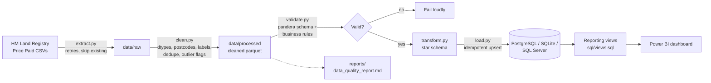
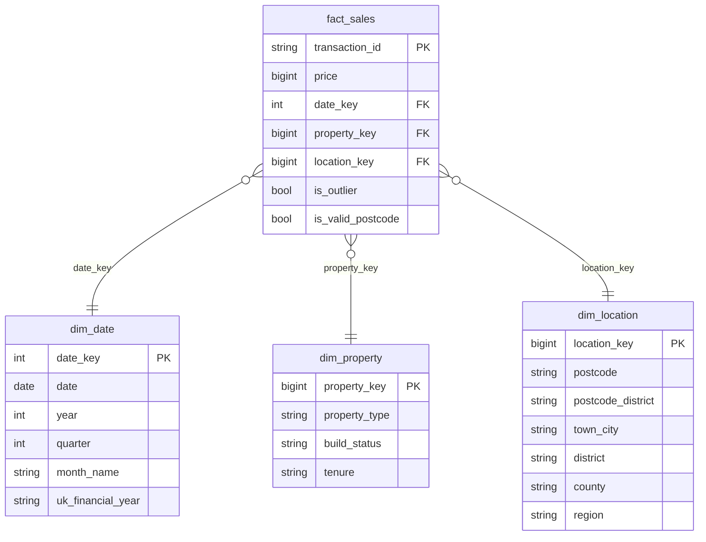

# UK Property Price Pipeline

[](https://github.com/Pulak-PSR/uk-property-price-pipeline/actions/workflows/ci.yml)

An end-to-end data pipeline for UK house sales. It downloads HM Land Registry Price Paid Data, cleans and validates it with Python, loads it into a SQL database as a star schema, and feeds a Power BI dashboard.

I ran it on 2023 to 2025: **2.77 million** property sales, from raw CSV to reporting views.

## Architecture



### Star schema



## Dataset and licence

**HM Land Registry Price Paid Data** for England and Wales: every residential property sale registered, one row per transaction.

- Source: <https://www.gov.uk/government/statistical-data-sets/price-paid-data-downloads>
- Licence: [Open Government Licence v3.0](https://www.nationalarchives.gov.uk/doc/open-government-licence/version/3/)
- Attribution: Contains HM Land Registry data (c) Crown copyright and database right 2026. This data is licensed under the Open Government Licence v3.0.

The data is **not** stored in this repository. The download URLs live in `config/config.yaml`, so they can be changed without touching code.

The postcode-area to region lookup in `data/reference/` is a small hand-built table (about 100 rows). Regions are assigned by postcode area, so a few areas that straddle a boundary (for example `CH`, `SY`) are an approximation.

## Setup

Requirements: Python 3.11+, Docker (for PostgreSQL), Git.

```bash
git clone https://github.com/Pulak-PSR/uk-property-price-pipeline.git
cd uk-property-price-pipeline

python -m venv .venv
# Windows: .venv\Scripts\activate    macOS/Linux: source .venv/bin/activate
pip install -e ".[dev]"

cp .env.example .env        # then edit the passwords
docker compose up -d        # starts PostgreSQL on localhost:5432
```

To use SQLite instead (no Docker), comment out the PostgreSQL `DATABASE_URL` in `.env` and use `sqlite:///data/processed/ukproperty.db`. SQL Server works the same way with an `mssql+pyodbc://` string.

## Run

```bash
# quick test on a random 50,000-row sample of one year
python -m uk_property_pipeline.run_pipeline --years 2025 --sample

# full run on the years in config/config.yaml (2023 to 2025)
python -m uk_property_pipeline.run_pipeline

# one stage at a time (reads the previous stage's saved output)
python -m uk_property_pipeline.run_pipeline --stage extract
python -m uk_property_pipeline.run_pipeline --stage clean
python -m uk_property_pipeline.run_pipeline --stage validate
python -m uk_property_pipeline.run_pipeline --stage transform
python -m uk_property_pipeline.run_pipeline --stage load
```

Re-running is safe: the load stage is idempotent.

### Tests and linting

```bash
pytest
ruff check .
ruff format --check .
```

## Pipeline stages

| Stage | Module | What it does |
|---|---|---|
| 1. Extract | `extract.py` | Downloads yearly CSVs with retries, progress logging, and skip-if-present. Writes to a `.part` file so a broken download is never mistaken for a complete one |
| 2. Clean | `clean.py` | Applies headers, enforces dtypes, parses dates, normalises text and postcodes (uppercase, single space, UK regex), maps codes to labels, applies record status (A/C/D), removes duplicates, flags outliers, writes the quality report |
| 3. Validate | `validate.py` | Pandera schema (types, domains, uniqueness, date range) plus business rules. Fails with a message per problem |
| 4. Transform | `transform.py` | Builds `fact_sales`, `dim_date` (with UK financial year Apr to Mar), `dim_property`, `dim_location` (with region) |
| 5. Load | `load.py` | Creates tables, keys and indexes through SQLAlchemy, loads via staging tables, rebuilds the views |
| CLI | `run_pipeline.py` | Runs it all: `--years`, `--stage`, `--sample` |

### Design decisions

- **Outliers are flagged, not deleted.** Two flags: price under 10,000 pounds, and a log-price IQR fence. Reporting views and DAX measures exclude flagged rows, but nothing is lost.
- **Stable surrogate keys.** Dimension keys are hashes of the natural key, so re-running or loading a new year never renumbers existing rows and the load needs no database lookups.
- **Idempotent load.** Dimensions insert only missing keys. Facts are replaced by `transaction_id` through a staging table, so re-runs do not duplicate rows and a Land Registry "change" record overwrites the earlier version.
- **Portable SQL.** The database is chosen by `DATABASE_URL` only. The load code uses plain SQL through SQLAlchemy, with no PostgreSQL-only features.

## Data-quality findings

From the full 2023 to 2025 run (full report: [`reports/data_quality_report.md`](reports/data_quality_report.md)):

| Check | Result |
|---|---:|
| Rows in / out | 2,767,042 / 2,767,042 |
| Duplicate transaction ids | 0 |
| Records with status D (deleted) | 0 |
| Missing price, date or transaction id | 0 |
| Invalid or missing postcodes | 7,428 (0.27%) |
| Sales under 10,000 pounds (flagged) | 8,872 |
| Log-price IQR outliers (flagged, includes the above) | 17,609 (0.64%) |
| Price range in raw data | 1 pound to 793 million pounds |

What this says:

- The yearly files are already de-duplicated and contain only "added" records, so the dedupe and delete logic is exercised by the unit tests rather than by this data.
- The extreme values matter. Without flagging, the 793 million pound sale (and thousands of 1 pound transfers) would distort averages.
- `saon` (flat or unit number) is empty for 87% of rows and `locality` for 62%. That is expected, not an error.
- About 6,700 sales end up with region `Unknown`, because their postcode is missing or invalid.

## Sample SQL insights

Computed on the cleaned data with outliers excluded (2.75 million sales). Queries are in [`sql/analysis_queries.sql`](sql/analysis_queries.sql).

**Average price by region, 2023 to 2025**

| Region | Sales | Average price |
|---|---:|---:|
| London | 313,984 | 660,737 |
| South East | 452,717 | 462,362 |
| East of England | 283,641 | 390,147 |
| South West | 299,069 | 374,429 |
| West Midlands | 255,420 | 292,693 |
| East Midlands | 202,324 | 287,109 |
| North West | 376,398 | 256,441 |
| Wales | 128,828 | 246,962 |
| Yorkshire and The Humber | 283,098 | 245,318 |
| North East | 147,253 | 198,726 |

London homes cost on average 3.3 times as much as the North East.

**Other findings**

- National average price was nearly flat: 362k (2023), 365k (2024), 366k (2025). The median rose from 275k to 285k.
- By type, detached homes average 505k against 285k for terraced.
- New builds average 388k against 362k for existing homes (about 7% higher), though the mix of property types differs.
- March is the busiest month (297k sales over three years), April the quietest of the spring months (165k). This is consistent with a rush ahead of the April stamp duty changes.
- Highest year-on-year district growth in 2025 (districts with at least 100 sales in both years): County Durham +8.9%, Ribble Valley +8.4%, Harlow +8.0%. Largest fall: Hammersmith and Fulham -11.3%.

## Power BI dashboard

Everything needed to build the report is in [`powerbi/`](powerbi/):

| File | Purpose |
|---|---|
| [`README_powerbi.md`](powerbi/README_powerbi.md) | Connect to PostgreSQL, import the views, set relationships |
| [`dax_measures.md`](powerbi/dax_measures.md) | Average, median, volume, YoY %, 3-month moving average, region rank |
| [`dashboard_spec.md`](powerbi/dashboard_spec.md) | 3-page layout with slicers for year, region and property type |
| [`theme.json`](powerbi/theme.json) | Custom theme |

Screenshots (to be added):

| Overview | Regional | Property types |
|---|---|---|
|  |  |  |

## Project structure

```
uk-property-price-pipeline/
├── .github/workflows/ci.yml      # lint + tests on push
├── config/config.yaml            # URLs, years, thresholds
├── data/
│   ├── raw/                      # downloaded CSVs (git-ignored)
│   ├── processed/                # parquet / SQLite output (git-ignored)
│   └── reference/                # postcode area -> region lookup
├── powerbi/                      # DAX, theme, spec, setup guide, screenshots
├── reports/data_quality_report.md
├── sql/                          # schema, views, analysis queries
├── src/uk_property_pipeline/     # extract, clean, validate, transform, load, CLI
├── tests/                        # pytest + fixtures
├── docker-compose.yml            # PostgreSQL
├── .env.example
└── pyproject.toml                # dependencies, ruff, pytest config
```

## Skills demonstrated

- **Python data engineering**: modular pipeline, pandas on millions of rows, type hints, docstrings, `logging`, argparse CLI
- **Data quality**: schema validation with pandera, business rules, flagged outliers, automated quality report
- **SQL and data modelling**: star schema, primary and foreign keys, indexes, window functions (`LAG`, `RANK`, moving averages), reporting views
- **Database engineering**: SQLAlchemy, idempotent loads, PostgreSQL via Docker, portable to SQLite and SQL Server
- **BI**: Power BI model design, DAX measures (time intelligence, ranking), dashboard specification
- **Software practice**: pytest unit and integration tests, ruff, GitHub Actions CI, config-driven design, no secrets or data in the repo

## Licence

Code: [MIT](LICENSE). Data: HM Land Registry, Open Government Licence v3.0.
